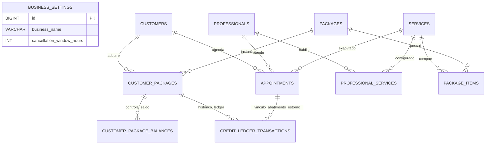

# Arquitetura e Modelagem do Banco de Dados - SoftBarber

## 1. Visão Geral e Decisão de Arquitetura

O sistema **SoftBarber** adota o modelo **Single-Tenant por Instância**. 
Cada cliente (salão, barbearia, manicure) possui sua própria base de dados e ambiente isolado.
- **Vantagens:** Isolamento total de dados, conformidade simplificada com LGPD, facilidade de backup/restauração individual, ausência de risco de vazamento de dados entre clientes concorrentes e flexibilidade para vender como SaaS dedicado ou licença instalada.
- **Impacto no Modelo:** Foram eliminados os campos `establishment_id`. As configurações específicas do salão são centralizadas na tabela `business_settings`.

---

## 2. Diagrama Entidade-Relacionamento (DER)



---

## 3. Estrutura DDL Completa (MariaDB / InnoDB)

```sql
-- 1. Configurações Globais do Estabelecimento (Instância Única)
CREATE TABLE business_settings (
    id BIGINT UNSIGNED AUTO_INCREMENT PRIMARY KEY,
    business_name VARCHAR(150) NOT NULL,
    cancellation_window_hours INT UNSIGNED DEFAULT 2, -- Janela de antecedência mínima p/ cancelamento com estorno
    default_slot_interval_minutes SMALLINT UNSIGNED DEFAULT 30,
    open_time TIME DEFAULT '08:00:00',
    close_time TIME DEFAULT '20:00:00',
    updated_at TIMESTAMP DEFAULT CURRENT_TIMESTAMP ON UPDATE CURRENT_TIMESTAMP
) ENGINE=InnoDB;

-- 2. Clientes
CREATE TABLE customers (
    id BIGINT UNSIGNED AUTO_INCREMENT PRIMARY KEY,
    name VARCHAR(150) NOT NULL,
    phone VARCHAR(20) NOT NULL,
    email VARCHAR(150) UNIQUE,
    notes TEXT NULL,
    created_at TIMESTAMP DEFAULT CURRENT_TIMESTAMP
) ENGINE=InnoDB;

-- 3. Profissionais
CREATE TABLE professionals (
    id BIGINT UNSIGNED AUTO_INCREMENT PRIMARY KEY,
    name VARCHAR(150) NOT NULL,
    phone VARCHAR(20) NULL,
    is_active BOOLEAN DEFAULT TRUE,
    created_at TIMESTAMP DEFAULT CURRENT_TIMESTAMP
) ENGINE=InnoDB;

-- 4. Serviços
CREATE TABLE services (
    id BIGINT UNSIGNED AUTO_INCREMENT PRIMARY KEY,
    name VARCHAR(120) NOT NULL,
    description TEXT NULL,
    duration_minutes SMALLINT UNSIGNED NOT NULL, -- Duração padrão para cálculo de slots na agenda
    price DECIMAL(10,2) NOT NULL,
    is_active BOOLEAN DEFAULT TRUE,
    created_at TIMESTAMP DEFAULT CURRENT_TIMESTAMP
) ENGINE=InnoDB;

-- 5. Serviços Habilitados por Profissional
CREATE TABLE professional_services (
    professional_id BIGINT UNSIGNED NOT NULL,
    service_id BIGINT UNSIGNED NOT NULL,
    custom_duration_minutes SMALLINT UNSIGNED NULL, -- Sobrescreve duração padrão se o profissional for mais rápido/lento
    PRIMARY KEY (professional_id, service_id),
    FOREIGN KEY (professional_id) REFERENCES professionals(id) ON DELETE CASCADE,
    FOREIGN KEY (service_id) REFERENCES services(id) ON DELETE CASCADE
) ENGINE=InnoDB;

-- 6. Catálogo de Pacotes Promocionais
CREATE TABLE packages (
    id BIGINT UNSIGNED AUTO_INCREMENT PRIMARY KEY,
    name VARCHAR(150) NOT NULL,
    description TEXT NULL,
    price DECIMAL(10,2) NOT NULL,
    validity_days INT UNSIGNED NOT NULL DEFAULT 90, -- Dias de validade a partir da data de compra
    is_active BOOLEAN DEFAULT TRUE,
    created_at TIMESTAMP DEFAULT CURRENT_TIMESTAMP
) ENGINE=InnoDB;

-- 7. Composição do Pacote (Itens inclusos)
CREATE TABLE package_items (
    id BIGINT UNSIGNED AUTO_INCREMENT PRIMARY KEY,
    package_id BIGINT UNSIGNED NOT NULL,
    service_id BIGINT UNSIGNED NOT NULL,
    quantity SMALLINT UNSIGNED NOT NULL, -- Ex: 4 sessões de Manicure ou 2 Barbas + 2 Cortes
    FOREIGN KEY (package_id) REFERENCES packages(id) ON DELETE CASCADE,
    FOREIGN KEY (service_id) REFERENCES services(id)
) ENGINE=InnoDB;

-- 8. Carteira de Pacotes do Cliente (Instância Comprada)
CREATE TABLE customer_packages (
    id BIGINT UNSIGNED AUTO_INCREMENT PRIMARY KEY,
    customer_id BIGINT UNSIGNED NOT NULL,
    package_id BIGINT UNSIGNED NOT NULL,
    status ENUM('ACTIVE', 'EXPIRED', 'EXHAUSTED', 'CANCELLED') NOT NULL DEFAULT 'ACTIVE',
    purchased_at TIMESTAMP DEFAULT CURRENT_TIMESTAMP,
    expires_at TIMESTAMP NOT NULL,
    FOREIGN KEY (customer_id) REFERENCES customers(id),
    FOREIGN KEY (package_id) REFERENCES packages(id)
) ENGINE=InnoDB;

-- 9. Saldo Vigente de Créditos por Serviço
CREATE TABLE customer_package_balances (
    id BIGINT UNSIGNED AUTO_INCREMENT PRIMARY KEY,
    customer_package_id BIGINT UNSIGNED NOT NULL,
    service_id BIGINT UNSIGNED NOT NULL,
    total_quantity SMALLINT UNSIGNED NOT NULL,
    remaining_quantity SMALLINT UNSIGNED NOT NULL,
    FOREIGN KEY (customer_package_id) REFERENCES customer_packages(id) ON DELETE CASCADE,
    FOREIGN KEY (service_id) REFERENCES services(id),
    CONSTRAINT chk_remaining_positive CHECK (remaining_quantity >= 0),
    UNIQUE KEY uq_pkg_service (customer_package_id, service_id)
) ENGINE=InnoDB;

-- 10. Agendamentos
CREATE TABLE appointments (
    id BIGINT UNSIGNED AUTO_INCREMENT PRIMARY KEY,
    professional_id BIGINT UNSIGNED NOT NULL,
    customer_id BIGINT UNSIGNED NOT NULL,
    service_id BIGINT UNSIGNED NOT NULL,
    start_time DATETIME NOT NULL,
    end_time DATETIME NOT NULL,
    status ENUM('BOOKED', 'CONFIRMED', 'COMPLETED', 'CANCELLED', 'NO_SHOW') NOT NULL DEFAULT 'BOOKED',
    payment_type ENUM('PACKAGE_CREDIT', 'AVULSO_LOCAL', 'AVULSO_ONLINE') NOT NULL,
    cancellation_reason VARCHAR(255) NULL,
    cancelled_at DATETIME NULL,
    created_at TIMESTAMP DEFAULT CURRENT_TIMESTAMP,
    FOREIGN KEY (professional_id) REFERENCES professionals(id),
    FOREIGN KEY (customer_id) REFERENCES customers(id),
    FOREIGN KEY (service_id) REFERENCES services(id),
    -- Índice para busca rápida de concorrência e agenda
    INDEX idx_prof_window (professional_id, start_time, end_time, status)
) ENGINE=InnoDB;

-- 11. Livro-Razão Imutável de Créditos (Ledger de Auditoria)
CREATE TABLE credit_ledger_transactions (
    id BIGINT UNSIGNED AUTO_INCREMENT PRIMARY KEY,
    customer_package_id BIGINT UNSIGNED NOT NULL,
    service_id BIGINT UNSIGNED NOT NULL,
    appointment_id BIGINT UNSIGNED NULL, -- NULL em compras, expirações ou ajustes manuais
    type ENUM('PURCHASE', 'DEBIT_BOOKING', 'REFUND_CANCELLATION', 'EXPIRATION', 'MANUAL_ADJUSTMENT') NOT NULL,
    amount INT NOT NULL, -- Ex: +4 (compra), -1 (agendamento), +1 (estorno)
    balance_after SMALLINT UNSIGNED NOT NULL,
    idempotency_key VARCHAR(100) UNIQUE NULL, -- Evita duplo clique / retries de rede
    notes VARCHAR(255) NULL,
    created_at TIMESTAMP DEFAULT CURRENT_TIMESTAMP,
    FOREIGN KEY (customer_package_id) REFERENCES customer_packages(id),
    FOREIGN KEY (service_id) REFERENCES services(id),
    FOREIGN KEY (appointment_id) REFERENCES appointments(id)
) ENGINE=InnoDB;
```

---

## 4. A Lógica Profunda do Banco de Dados

### 4.1. Por que separar `packages`, `customer_packages` e `customer_package_balances`?
* **`packages` (Catálogo):** É o modelo que o dono do salão cadastra. Ex: "Pacote Mensal - R$ 120". Se o dono alterar o preço do pacote amanhã para R$ 150, quem já comprou no passado não pode sofrer alteração.
* **`customer_packages` (Contrato/Carteira):** É o registro da compra do cliente. Ele fixa a data de compra e a data de expiração (`expires_at`), que é imutável para aquele cliente.
* **`customer_package_balances` (Saldo por Serviço):** Permite que um pacote contenha múltiplos tipos de serviços (ex: 2 Cortes + 2 Barbas). Cada serviço tem seu próprio contador de créditos disponíveis (`remaining_quantity`).

### 4.2. O Conceito de Livro-Razão (Credit Ledger) e Auditoria Imutável
Em sistemas financeiros e contábeis, **nunca se confia apenas em um campo de saldo estático**. 
* Se houver apenas `UPDATE balance = balance - 1`, ninguém sabe quem descontou, que horas descontou, se foi erro do sistema ou se foi estornado.
* Com a tabela `credit_ledger_transactions`:
  - **Histórico 100% auditável:** É impossível haver saldo misterioso. A soma de todas as transações de um pacote deve bater exatamente com o `remaining_quantity`.
  - **Imutabilidade:** Linhas nesta tabela **nunca sofrem UPDATE ou DELETE**. Se um agendamento for cancelado, insere-se uma nova linha `REFUND_CANCELLATION (+1)`.
  - **Idempotência:** A coluna `idempotency_key` garante que uma oscilação de rede (ex: cliente clicando duas vezes em "Confirmar") não gere dois abatimentos.

### 4.3. Prevenção de Concorrência e Race Conditions
Dois cenários críticos de concorrência:

#### Cenário A: Duplo Agendamento (Dois clientes escolhem o mesmo horário com o mesmo barbeiro)
* **Solução:** Na transação de agendamento no FastAPI:
  1. Abre-se uma transação ACID.
  2. Executa-se `SELECT id FROM appointments WHERE professional_id = :p AND status NOT IN ('CANCELLED') AND (start_time < :end AND end_time > :start) FOR UPDATE;`.
  3. O lock pessimista (`FOR UPDATE`) força qualquer requisição concorrente a aguardar a finalização da primeira. Se a primeira criar o agendamento, a segunda encontrará conflito e retornará `409 Conflict`.

#### Cenário B: Gasto Duplo de Crédito (Cliente com 1 crédito restante dispara 2 agendamentos simultâneos)
* **Solução:**
  1. `SELECT remaining_quantity FROM customer_package_balances WHERE id = :id FOR UPDATE;`.
  2. O banco bloqueia a linha de saldo para leitura e escrita por outra transação.
  3. A constraint de segurança no MariaDB `CONSTRAINT chk_remaining_positive CHECK (remaining_quantity >= 0)` atua como uma barreira física garantindo que o saldo nunca fique negativo.

---

## 5. Mapeamento de Endpoints da API REST (FastAPI)

1. **`POST /api/v1/packages/purchase`**
   - Cria o `customer_package`, popula os `customer_package_balances` e gera o registro inicial no `credit_ledger_transactions` (`type = 'PURCHASE'`).
2. **`GET /api/v1/customers/{customer_id}/packages`**
   - Retorna a lista de pacotes do cliente com seus respectivos saldos vigentes e prazos de validade.
3. **`GET /api/v1/professionals/{professional_id}/available-slots`**
   - Calcula os horários livres com base na duração do serviço escolhido e nos agendamentos já confirmados no dia.
4. **`POST /api/v1/appointments/book-with-credit`**
   - Transação atômica que valida a agenda, abate 1 crédito com `FOR UPDATE`, gera o agendamento e registra no Ledger (`DEBIT_BOOKING`).
5. **`POST /api/v1/appointments/{appointment_id}/cancel`**
   - Cancela o agendamento. Se `now <= start_time - cancellation_window_hours`, estorna o crédito (+1) no Ledger e reabre o saldo.
