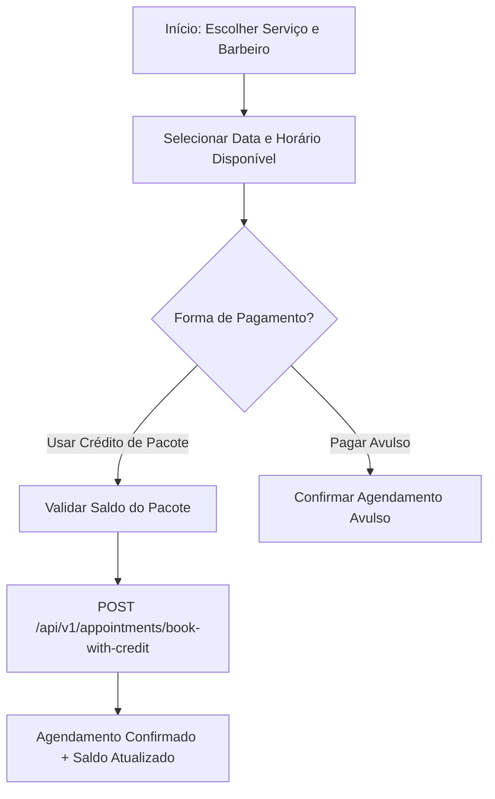

# Especificação de Design: Frontend Web do SoftBarber (React + TypeScript)

## 1. Visão Geral e Objetivos

O Frontend do **SoftBarber** é uma Single-Page Application (SPA) moderna, responsiva e mobile-first, desenvolvida em **React 18 com TypeScript, Vite e Tailwind CSS**.
O sistema atende a dois perfis de usuários:
1. **Cliente Final (Mobile-First):** Focado em rapidez para consultar serviços, adquirir pacotes, acompanhar saldo de créditos na carteira, agendar horários em tempo real e gerenciar cancelamentos com estorno.
2. **Profissional / Salão (Desktop & Tablet Friendly):** Focado em gerenciar a agenda diária, visualizar agendamentos confirmados e auditar o histórico de créditos dos clientes.

---

## 2. Identidade Visual e Experiência do Usuário (UI/UX)

- **Tema:** Dark Mode elegante e acolhedor, característico de barbearias e salões modernos (`bg-zinc-950`, `bg-zinc-900`, bordas em `zinc-800`, textos em `zinc-100` e destaques na cor âmbar/dourado `amber-500` / `amber-400`).
- **Mobile-First:** Navegação rápida por abas na parte inferior (Bottom Navigation) no mobile e Header superior limpo no desktop.
- **Feedback em Tempo Real:** Badges com status de agendamentos (`BOOKED`, `CANCELLED`), badges de saldo de pacotes ("3 restantes • Válido até 10/12") e confirmações de transação.

---

## 3. Mapeamento de Telas e Fluxos

### Fluxo 1: Vitrine de Serviços e Agendamento com Crédito (Cliente)


### Fluxo 2: Gestão de Pacotes e Carteira (Cliente)
1. **Aba "Pacotes":** Lista os pacotes promocionais disponíveis no salão (ex: "Combo 4 Cortes - R$ 120,00").
2. **Botão "Comprar Pacote":** Dispara `POST /api/v1/packages/purchase` e inicializa a carteira com o saldo de créditos.
3. **Aba "Minha Carteira":** Exibe pacotes ativos, créditos restantes por serviço, data fatal de expiração e indicador visual de validade.

### Fluxo 3: Meus Agendamentos e Cancelamento com Estorno
1. Lista os agendamentos futuros do cliente.
2. Botão **"Cancelar Horário"**:
   - Exibe a política de cancelamento: *"Cancelamentos com mais de 2 horas de antecedência estornam seu crédito automaticamente para a carteira"*.
   - Dispara `POST /api/v1/appointments/{id}/cancel`.
   - Se dentro do prazo, exibe notificação de sucesso: *"Agendamento cancelado e 1 crédito devolvido à sua carteira!"*.

### Fluxo 4: Painel do Profissional (Agenda e Visão do Dia)
1. Seletor de profissional e de data.
2. Linha do tempo visual dos horários agendados x horários livres.
3. Resumo dos atendimentos do dia.

---

## 4. Arquitetura de Pastas do Frontend

```
c:\SoftBarber\frontend\
├── src/
│   ├── api/
│   │   ├── client.ts             # Instância Axios/Fetch com baseURL do backend
│   │   ├── packages.ts           # Endpoints de pacotes e carteira
│   │   ├── appointments.ts       # Endpoints de agendamentos e cancelamento
│   │   └── schedule.ts           # Endpoints de slots disponíveis
│   ├── components/
│   │   ├── layout/
│   │   │   ├── Header.tsx        # Top navigation
│   │   │   └── BottomNav.tsx     # Mobile bottom bar
│   │   ├── common/
│   │   │   ├── Badge.tsx
│   │   │   ├── Button.tsx
│   │   │   └── Modal.tsx
│   │   ├── booking/
│   │   │   ├── ServiceCard.tsx
│   │   │   ├── SlotPicker.tsx    # Seletor de horário disponível
│   │   │   └── BookingModal.tsx
│   │   ├── packages/
│   │   │   ├── PackageCard.tsx   # Vitrine de compra
│   │   │   └── WalletBalance.tsx # Exibição de saldos na carteira
│   │   └── appointments/
│   │       └── AppointmentCard.tsx
│   ├── pages/
│   │   ├── ClientPortal.tsx      # Hub do cliente (Agendar, Pacotes, Carteira, Histórico)
│   │   └── AdminDashboard.tsx    # Hub do salão/barbeiro (Visão da Agenda diária)
│   ├── types/
│   │   └── api.ts                # Interfaces TypeScript sincronizadas com o backend
│   ├── App.tsx                   # Roteamento e layout
│   └── main.tsx
├── package.json
├── tailwind.config.js
├── vite.config.ts
└── tsconfig.json
```

---

## 5. Integração com a API do Backend FastAPI

O frontend se comunica diretamente com a API montada no backend:
- `GET /api/v1/professionals/{id}/available-slots?service_id={id}&date={YYYY-MM-DD}`
- `POST /api/v1/packages/purchase` (com `Idempotency-Key` gerada por UUID)
- `GET /api/v1/customers/{id}/packages`
- `POST /api/v1/appointments/book-with-credit`
- `POST /api/v1/appointments/{id}/cancel`
